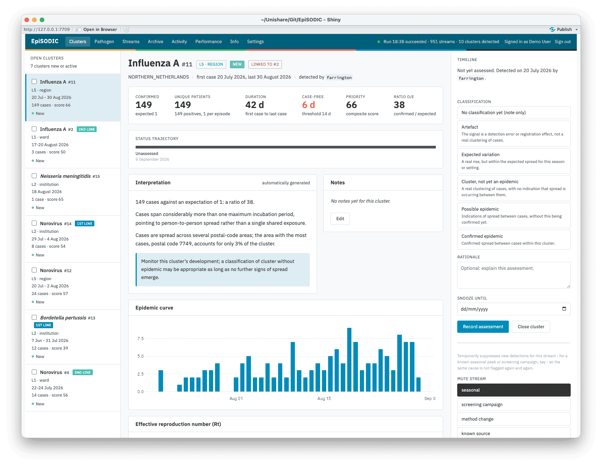
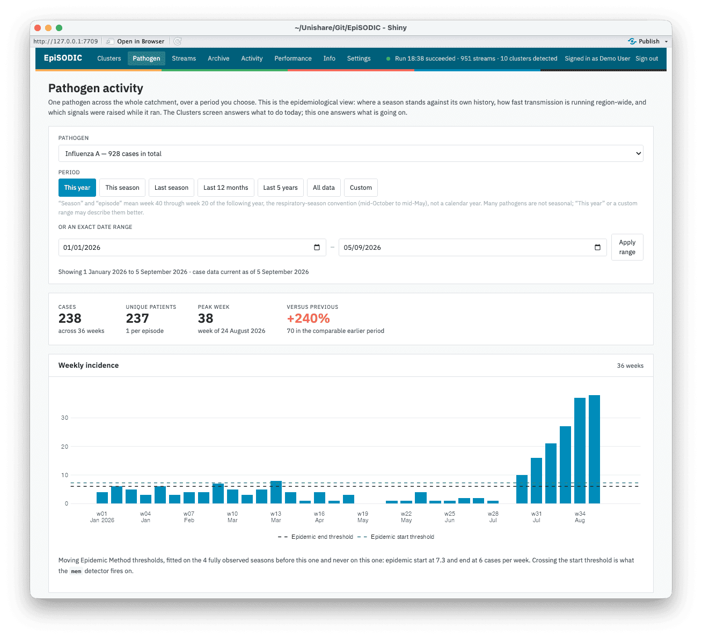
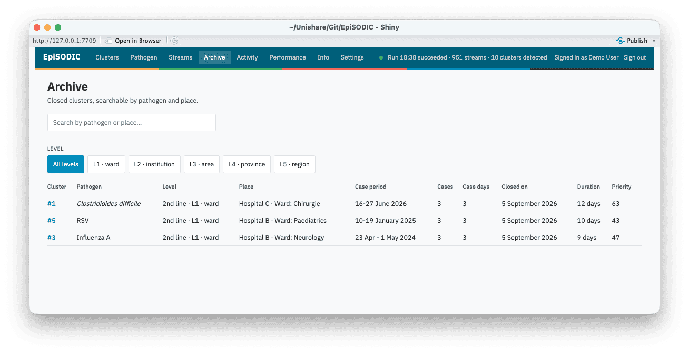

# EpiSODIC: Epidemiological Signal Observation, Detection, Identification, and Classification

[](https://github.com/certe-medical-epidemiology/EpiSODIC/actions/workflows/R-CMD-check.yaml)

> [!WARNING]
> **Under very intensive development.** EpiSODIC has not been released and is not yet ready for use. Its functions, database schema, configuration and output can change substantially from one version to the next. While already fully functional, please use it only for testing until a first release is announced.

**An early warning system for infectious disease outbreaks, built to run in any laboratory, in any country.**

<!--
Screenshots below live in man/figures/ (ships with the package, so
they also render on the CRAN page), regenerated against episodic_demo().
-->
<p align="center">
  
  <br>
  <em>A cluster dossier - case stats, status trajectory, an automatically generated interpretation of the evidence, the epidemic curve, and the classification panel, alongside the rail of open clusters.</em>
</p>

Statistical methods for spotting an unusual rise in infections are not new. The Farrington algorithm and its successors have run at national public health institutes since the early 1990s, and R has long had a solid reference implementation in the `surveillance` package. What has been missing is not a better method, but a system that actually runs one, day after day, in an ordinary laboratory: one that signals at ward level as readily as across a whole region, records each assessment an epidemiologist or surveillance scientist makes, and runs reliably while giving everyone involved a clear picture.

**EpiSODIC is that system.** It takes a stream of laboratory-confirmed infections and carries it all the way from statistical detection through reconciliation into persistent clusters, structured epidemiologist assessment with a full audit trail, to an outbreak report ready for clinical colleagues, fully automated and running on a schedule of your choosing.

### It Detects
Combines the Improved Farrington method with rule-based detectors for pathogens too rare for a statistical baseline, and the Moving Epidemic Method for seasonal ones such as influenza and RSV, applied automatically across every ward, institution, and region in your data.

### It Reconciles
Recognises the same signal across repeated runs and across geographic levels, so one outbreak stays one dossier, not a pile of restatements.

### It Assesses
Gives epidemiologists a dossier per cluster with an automatically generated interpretation of the evidence, and records every judgement made on it, kept as a full, immutable audit trail.

### It Reports
Turns a confirmed cluster into an outbreak report for clinical microbiologists and infection prevention practitioners, rendered in the language your colleagues read, with every new version showing what changed since the last one. A cluster can also be put on a recurring schedule - every N days, to a list of addresses - so colleagues without a dashboard account still get their update automatically.

### It Notifies
Pushes new clusters to your team the moment they arise, by email, Microsoft Teams, Slack, or even an ntfy server.

### It Adapts
Works against any laboratory information system, any coding system, any administrative geography. Nothing about how it interprets your data is hardcoded.

An instance needs R, a database (SQLite, MariaDB or MySQL) and a regular case extract from your laboratory information system; `vignette("deployment")` describes the steps. Case data is stored only on infrastructure you control, and leaves it only through channels you configure yourself, such as notifications and exports to other instances. The dashboard and its outbreak reports are available in English, (Modern Standard) Arabic, Dutch, French, German, Hindi, Mandarin Chinese, and Spanish.

This software is free and open-source under the GNU GPL-2, and all of its code is open to anyone who wants or needs to assess it.

<p align="center">
  
  <br>
  <em>The Pathogen screen - weekly numbers of cases, reproduction number, with geographic and demographic distribution.</em>
</p>
<p align="center">
  
  <br>
  <em>The Archive screen - previously detected clusters.</em>
</p>

## Installation

```r
# install.packages("remotes")
remotes::install_github("certe-medical-epidemiology/EpiSODIC")
```

## See it work, right now

No data, no credentials, no configuration - one call runs the whole system against bundled synthetic data:

```r
EpiSODIC::episodic_demo()
```

This creates a temporary database, runs one detection cycle, provisions a demo epidemiologist account (printed to the console), and opens the app. Pass `launch = FALSE` to skip opening the app and just get a populated database path back, e.g. for scripting.

## What has and has not been measured

- **Detection performance** has been measured on synthetic data with known, injected outbreaks: sensitivity, timeliness and false alarms per stream-week, with a negative control and naive comparators ([Measuring detection against known truth](https://certe-medical-epidemiology.github.io/EpiSODIC/articles/detection-validation.html)). It has not yet been evaluated retrospectively against documented outbreaks in real laboratory data.
- **Testing intensity** is not corrected for. Farrington takes a patient-day offset at institution level where activity data is supplied; every other detection counts cases, so a rise in testing can raise a signal. Repeat samples within one episode are deduplicated before detection, and test counts, if supplied, are shown on the dossier as an aid to judgement but never enter detection ([Detection and reconciliation](https://certe-medical-epidemiology.github.io/EpiSODIC/articles/detection-reconciliation.html)).
- **Multiplicity** is not controlled. Each stream is tested at its own significance level; suppression removes restatements of one signal across geographic levels, not independent false alarms. The expected number of alarms grows with the number of pathogens and places watched.
- **The board's verdicts** yield a positive predictive value per detector and pathogen on the Performance screen, but only over clusters someone assessed. Clusters that close unassessed carry no verdict, and missed outbreaks never appear at all.

## Documentation

Everything past "what is this and how do I try it" lives in the package's vignettes, so it stays organised by topic instead of one long page:

| Read this... | ...for |
|---|---|
| [Overview](https://certe-medical-epidemiology.github.io/EpiSODIC/articles/overview.html) | What EpiSODIC does: the Clusters and Pathogen screens' two altitudes, and the Performance, Archive, Streams, Activity and Info screens around them. |
| [Getting your data in](https://certe-medical-epidemiology.github.io/EpiSODIC/articles/data-format.html) | The case data requirements - every column, what's optional, `episodic_check_cases()`/`episodic_check_denominators()`/`episodic_check_institution_activity()` to check your extract before anything runs, and `episodic_add_manual_cluster()` for clusters detected by another system entirely. |
| [Deployment](https://certe-medical-epidemiology.github.io/EpiSODIC/articles/deployment.html) | Standing up a real instance: scheduling, accounts, the database backend, custom report templates. |
| [Environment variables](https://certe-medical-epidemiology.github.io/EpiSODIC/articles/environment-variables.html) | The full `EPISODIC_*` reference table. |
| [Detection and reconciliation](https://certe-medical-epidemiology.github.io/EpiSODIC/articles/detection-reconciliation.html) | How a laboratory result becomes a dossier: the four detectors, denominators, reconciliation, and suppression. |
| [Measuring detection against known truth](https://certe-medical-epidemiology.github.io/EpiSODIC/articles/detection-validation.html) | How detection is validated against synthetic outbreaks, and what that does not measure. |
| [FAQ](https://certe-medical-epidemiology.github.io/EpiSODIC/articles/faq.html) | Answers to the questions that come up most often when getting started. |

Building the package locally (or browsing offline) works the same way: `vignette(package = "EpiSODIC")` lists all of them, and `vignette("data-format", package = "EpiSODIC")` (etc.) opens one.

## Licence

GPL-2.
